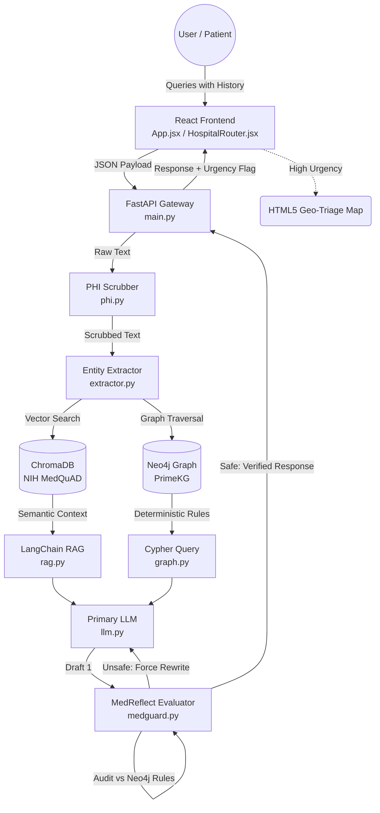

# 🛡️ MedGPT Guardian

**An Advanced, Privacy-First AI Clinical Decision Support System**

MedGPT Guardian is an academic research prototype (B.Tech Computer Science) designed to solve the most dangerous problem in medical AI: **Hallucinations**. Standard Large Language Models (LLMs) suffer from "sycophancy"—a bias to agree with the user. In healthcare, if an AI agrees to prescribe a contraindicated drug, it can be fatal. 

MedGPT Guardian eliminates this by utilizing a **Dual-Retrieval Architecture** (Semantic RAG + Deterministic Knowledge Graph) and an adversarial **Generator-Evaluator Safety Loop (MedReflect)**. It mathematically forces the AI to obey strict medical rules before the user ever sees the response.

---

## 🏗️ System Architecture Diagram



---

## 📖 Deep Dive into Core Modules

### 1. Privacy-First API Gateway (`phi.py`)
HIPAA and GDPR compliance is the first step of the pipeline. Before the AI ever sees the user's prompt, our rule-based and NLP-driven PHI (Protected Health Information) Scrubber intercepts the text. 
* **What it does:** Automatically redacts names (e.g., "John Doe"), 9-digit patient IDs, phone numbers, and emails.
* **Why it matters:** Ensures sensitive patient data never leaks into external LLM servers.

### 2. Dual-Retrieval Engine (`rag.py` & `graph.py`)
When a query enters the backend, it splits into two parallel search paths:
* **Semantic RAG (`rag.py`):** Uses Hugging Face embeddings (`all-MiniLM-L6-v2`) to convert the text into math. It searches a local **ChromaDB** vector database populated with the **NIH MedQuAD** dataset to pull relevant medical literature.
* **Knowledge Graph (`graph.py`):** The `extractor.py` module identifies clinical keywords (Drugs, Conditions). It translates these into Cypher queries and searches a **Neo4j** graph database (built on the **Harvard PrimeKG** dataset) to find strict medical rules.

### 3. The MedReflect Safety Loop (`medguard.py`)
This is the heart of the system—an adversarial "Generator-Evaluator" pattern.
* **Draft Generation:** The Primary LLM writes a draft based on the ChromaDB literature.
* **The Audit (Round 1):** An autonomous Secondary Evaluator LLM reads the draft and compares it strictly against the Neo4j graph rules.
* **The Correction (Round 2):** If the Evaluator detects a dangerous recommendation, it intercepts the response, logs an "Unsafe / Risk Detected" flag, and forces the Primary LLM to rewrite the answer. This loops until 100% graph compliance is achieved.

### 4. Stateless Multi-Turn Memory (`App.jsx`)
Instead of storing chat history in a slow backend database, the React frontend handles all conversation memory using browser `localStorage`. 
* **Why it matters:** The FastAPI backend remains entirely stateless. This eliminates database I/O latency, allowing the system to remember past symptoms without slowing down the server.

### 5. HTML5 Geo-Triage Routing (`HospitalRouter.jsx`)
AI advice is useless in an emergency without physical care. Based on the clinical urgency level determined by the backend, this React component requests the user's browser HTML5 geolocation. It then routes the user to the nearest Level-1 trauma centers or OPDs in the Greater Noida/Delhi NCR region.

---

## 📂 Complete Repository Folder Structure

```text
medgpt-guardian/
│
├── backend/                              # FastAPI Microservice (Stateless Backend)
│   ├── app/
│   │   ├── api/                          # API routing and endpoint definitions
│   │   ├── chroma_db/                    # Local Vector Database (NIH MedQuAD Embeddings)
│   │   │   ├── 107572ca-8d3f-4b4b-.../   # ChromaDB UUID index folder
│   │   │   └── chroma.sqlite3            # Vector metadata database
│   │   ├── core/                         # The AI Brain & Orchestration Logic
│   │   │   ├── __pycache__/              # Python compiled bytecode
│   │   │   ├── config.py                 # System configurations & env loading
│   │   │   ├── extractor.py              # NLP clinical entity extraction
│   │   │   ├── graph.py                  # Neo4j Cypher queries & PrimeKG traversal
│   │   │   ├── llm.py                    # Primary LLM interface orchestration
│   │   │   ├── medguard.py               # MedReflect Generator-Evaluator safety loop
│   │   │   ├── phi.py                    # HIPAA/GDPR PII & PHI Scrubber
│   │   │   ├── rag.py                    # LangChain prompt assembly & ChromaDB retrieval
│   │   │   ├── resolver.py               # Conflict resolution for multi-morbidity
│   │   │   └── rxnav_api.py              # Auxiliary drug normalization
│   │   └── data/
│   │       └── kg/                       # Dimensional CSVs populating the Neo4j Graph
│   │           ├── dim1_disease.csv
│   │           ├── dim2_drug.csv
│   │           ├── dim3_allergy.csv
│   │           ├── dim4_factor.csv       
│   │           ├── dim5_lab.csv          
│   │           ├── dim6_indication.csv
│   │           └── guidelines.txt        # Text-based fallback guidelines
│   ├── scripts/                          # Database ingestion and graph visualization
│   │   ├── enterprise_seed_5D.py         # Seed script for Neo4j database
│   │   └── inspectgraph.py               # Script to validate graph nodes/edges
│   ├── venv/                             # Python Virtual Environment
│   ├── .env                              # Secret API keys & Database URIs (Ignored in Git)
│   ├── kg4.csv                           # Auxiliary knowledge graph staging data
│   ├── requirements.txt                  # Python dependencies (FastAPI, LangChain, Neo4j)
│   └── test_query.py                     # Automated backend testing script
│
└── frontend/                             # React / Vite Client
    ├── node_modules/                     # NPM dependencies
    ├── public/                           # Static assets
    ├── src/
    │   ├── assets/                       # Image and UI assets
    │   ├── App.css                       # Application-specific styling
    │   ├── App.jsx                       # Main UI & localStorage Context Manager
    │   ├── HospitalRouter.jsx            # HTML5 Geolocation & Triage Component
    │   ├── index.css                     # Tailwind CSS entry point
    │   └── main.jsx                      # React DOM rendering entry point
    ├── .gitignore                        # Git exclusion rules
    ├── eslint.config.js                  # Linter configuration for code quality
    ├── package-lock.json                 # Locked dependency versions
    ├── package.json                      # Node.js project metadata and scripts
    ├── postcss.config.js                 # PostCSS configuration (used by Tailwind)
    ├── README.md                         # Frontend-specific documentation
    ├── tailwind.config.js                # Tailwind CSS theme configuration
    └── vite.config.js                    # Vite bundler configuration
```

---

## 📊 Experimental Results (Mid-Term Validation)

* **Adversarial Safety Testing:** In synthetic stress tests (e.g., patient with severe asthma requesting Propranolol), the MedReflect loop successfully intercepted the primary draft, matched the contraindicated nodes in Neo4j, blocked the unsafe recommendation, and executed a secondary recovery round to autonomously generate a safe response.
* **Latency Metrics:** Complete end-to-end pipeline execution—including vector retrieval, graph traversal, generation, and a full 2-round MedReflect recovery loop—completes in **~13.84 seconds**.
* **Privacy Validation:** The `phi.py` scrubber achieved a **100% redaction rate** during synthetic payload injection tests containing 9-digit patient IDs and names.
* **Memory Validation:** Multi-turn memory successfully chained 5+ sequential queries via React `localStorage` without context loss or session drift.

---

## 🛠️ Setup & Installation Guide

### 1. Prerequisites
* Node.js (v18+)
* Python (3.10+)
* Neo4j Desktop or AuraDB instance

### 2. Backend Setup (FastAPI)
```bash
cd backend
python -m venv venv
# On Windows: venv\Scripts\activate
# On Mac/Linux: source venv/bin/activate
pip install -r requirements.txt
```
*Create a `.env` file in the `backend/` directory. Add your LLM API keys, Hugging Face Token, and Neo4j credentials.*

### 3. Database Initialization (Neo4j)
Seed the Neo4j database with the dimensional CSVs to build the deterministic graph constraints:
```bash
cd backend/scripts
python enterprise_seed_5D.py
```

### 4. Frontend Setup (React/Vite)
```bash
cd frontend
npm install
npm run dev
```

---

## 🔮 Future Roadmap & Pending Work

* **Google Maps API Integration:** Upgrading the `HospitalRouter.jsx` component from simulated mock-data to the live Google Places/Maps API for dynamic production-grade routing (pending premium API key acquisition).
* **Graph Expansion:** Migrating additional dimensional CSV data (`dim4_factor.csv`, `dim5_lab.csv`) into the Neo4j Knowledge Graph to handle complex multi-morbidity edge cases and lab-value contradictions.
* **Latency Optimization:** Further optimizing the MedReflect loop to reduce execution time below 10 seconds during complex multi-round reflection scenarios.

---
*Disclaimer: MedGPT Guardian is a B.Tech Computer Science academic research prototype designed to explore AI architecture, deterministic safety constraints, and RAG pipelines. It has not been clinically validated by the FDA and must not be used for real-world medical diagnosis or treatment.*
